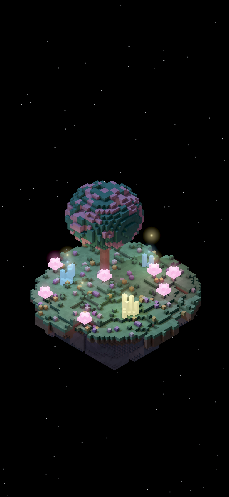
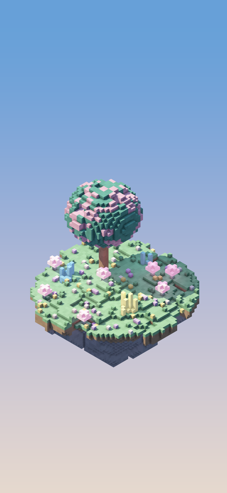
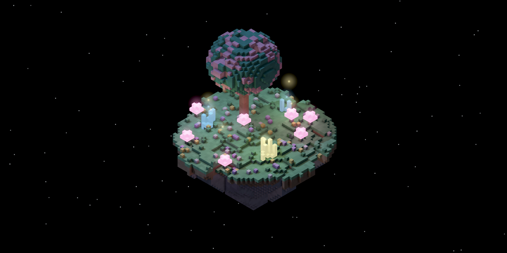

<p align="center">
  
  &nbsp;&nbsp;
  
</p>

<h1 align="center">Terrarium</h1>

<p align="center">
  <b>Your GitHub year, grown into a tiny voxel world.</b><br>
  Ray traced in <a href="https://github.com/bendlang/bend">Bend</a>, on every core, as phone wallpapers.<br>
  The night one is AMOLED: the sky is true black, so the pixels are off.
</p>

---

Every night a GitHub Action reads your profile and regrows your island.
The images above are mine, regrown from my own activity every night.

## How your profile grows it

| On GitHub | In the terrarium |
|---|---|
| Contributions this year | The size of the tree |
| Longest streak | Blossoms in its canopy |
| Active days | Glowing mushrooms |
| Current streak | Fireflies, one per day (at night) |
| Pull requests | Wildflowers in the grass |
| Your top 3 languages | Crystal clusters in those languages' GitHub colours |
| Stars on your repositories | Stars in the night sky, one each |
| No activity for 30 days | The island hibernates under snow |
| Your login | The seed: the shape of the island and where everything grows |

No two islands are the same, and yours changes as you work.

## Laws: the scene is proven, not just tested

Bend checks proofs. [`LAWS.bend`](LAWS.bend) states what the terrarium promises,
whatever profile it grows from, and [`PROOF.bend`](PROOF.bend) proves it:

- **every_mushroom_glows**: every mushroom that grows is also a light source. No dark mushrooms, no ghost lights.
- **fireflies_count**: asking for *n* fireflies gives exactly *n* firefly lights.
- **one_firefly_per_streak_day**: at night, one firefly per day of your current streak (up to 16).
- **no_fireflies_by_day**: by day there are none, whatever the streak.

`bend PROOF.bend` is the gate. CI runs it on every push, and the Action runs
it before every render. Break the code (say, a refactor that forgets the
light of every seventh mushroom) and the build stops with the law it broke:

```
SOME PROOFS FAIL
- expected : {List.length(.., S.Lights.put(Bool.and(S.Mush.ok(..), ..), ..)) == S.Mush.add(S.Mush.ok(..), ..)}
Location: Laws.every_mushroom_glows
```

Bend's floats are axiomatic, so geometry and colours are not claimed. The laws cover the discrete
parts of the scene, the things you count.

## Grow your own

1. Create (or open) the repository named after your login: `<you>/<you>`, your profile README.
2. Add `.github/workflows/terrarium.yml`:

   ```yaml
   name: terrarium
   on:
     schedule:
       - cron: "23 4 * * *"
     workflow_dispatch:
   permissions:
     contents: write
   jobs:
     grow:
       runs-on: ubuntu-latest
       steps:
         - uses: actions/checkout@v4
         - uses: antomanc/terrarium@main
   ```

3. Run it once from the Actions tab. It commits `terrarium/banner-night.png`, `terrarium/phone-night.png` and their day twins.
4. Show it in your README:

   ```html
   
   ```

5. Set the night one as your phone's wallpaper.

| Input | Default | |
|---|---|---|
| `username` | the repository owner | whose activity grows the island |
| `token` | `github.token` | private contributions count only if your profile shows them; a PAT with `read:user` also works |
| `sizes` | `banner phone` | presets or `WIDTHxHEIGHT`, space-separated: see below |
| `modes` | `night day` | `night` is AMOLED black, `day` has a blue sky |
| `out` | `terrarium` | where the images go, as `<size>-<mode>.png` |
| `commit` | `true` | commit and push the images |

### Sizes

| Preset | Pixels | For |
|---|---|---|
| `banner` | 1280×640 | the top of a profile README |
| `phone` | 1080×2340 | most 20:9 phones |
| `phone-hd` | 1440×3120 | QHD+ phones |
| `fold-cover` | 1080×2520 | a Galaxy Z Fold cover screen |
| `fold-inner` | 1968×2184 | a Galaxy Z Fold inner screen, held as a book |
| `tablet` | 1600×2560 | portrait tablets |
| `desktop` | 3840×2160 | 4K monitors |
| `square` | 1080×1080 | avatars and posts |

Any `WIDTHxHEIGHT` works too, e.g. `sizes: banner 1440x3200`. The island frames itself in any
aspect: low on tall screens (under the lock-screen clock), centered on wide ones.

## Run it locally

```sh
curl -fsSL https://bend-lang.com/install.sh | sh   # Bend, plus clang 14 or newer
bend PROOF.bend                                    # the laws
bend scene.bend -o scene                           # the renderer
node terrarium.mjs [login] --out out --sizes "banner phone" --modes "night day"
                                                   # uses $GITHUB_TOKEN or `gh auth token`
```

## How it works

- [`terrarium.mjs`](terrarium.mjs) reads a profile through the GraphQL API and passes twelve numbers to the renderer, then encodes the PNGs. It has no dependencies.
- [`scene.bend`](scene.bend) does the rest, in pure Bend:
  - **Grows** the garden from those numbers.
  - **Voxelizes** a 64³ island procedurally: no scene data, a function per voxel.
  - **Ray traces** it in isometric projection: grid traversal (DDA), moon or sun shadows, voxel ambient occlusion, coloured light from every mushroom, crystal and firefly, and 4 samples per pixel.
  - **Splits the work**: the rows of a frame are split in a binary tree of parallel calls, which Bend spreads over every core with no threads or locks in the code. A 1080×2340 frame takes about 5 s on 16 cores, and about 25 s on a GitHub runner.

## Limits

- The renderer runs on the CPU. Bend can run the same code on a GPU, but the Action's runners have none.
- GitHub returns at most 100 of your repositories for languages and stars.
- `bend PROOF.bend --verdict`, the recheck by Bend's Lean-proven kernel, needs Lean installed, so CI does not run it.

## License

MIT
